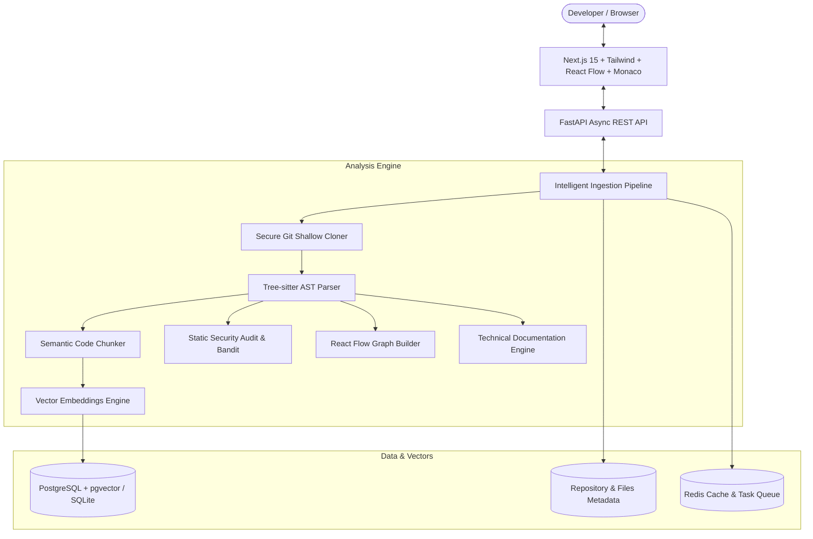

<div align="center">

# 🧠 RepoMind AI

### *Understand Any Codebase. Instantly.*

[](https://github.com/repomind-ai/repomind-ai/actions)
[](https://opensource.org/licenses/MIT)
[](https://www.python.org/)
[](https://nextjs.org/)
[](https://fastapi.tiangolo.com/)
[](https://reactflow.dev/)
[](https://www.docker.com/)

**RepoMind AI** is an enterprise-grade, high-performance GitHub repository intelligence platform. It ingests any public or private GitHub repository, parses abstract syntax trees (AST) across 15+ languages using Tree-sitter, runs static code security audits, generates interactive architecture graphs, and enables fact-grounded semantic code chat with precise file and line references.

[Key Features](#-key-features) •
[Architecture](#-architecture) •
[Quickstart](#-quickstart) •
[Local Development](#-local-development) •
[API Reference](#-api-reference) •
[Contributing](#-contributing)

</div>

---

## ✨ Key Features

- **⚡ Instant Ingestion & AST Parsing:** Shallow git cloning with Tree-sitter AST parsing for Python, TypeScript, JavaScript, Go, Rust, Java, C, C++, and fallback support for 10+ additional languages.
- **💬 Fact-Grounded AI Code Chat:** Conversational assistant with semantic vector search. Answers are strictly grounded in indexed code evidence, citing exact file paths and line ranges (`[auth/jwt.py:15-35]`). Zero hallucinations.
- **🗺️ Interactive Architecture Explorer:** Built with React Flow. Automatically extracts and visualizes component tiers (Entrypoints, Routes, Services, Models, UI, Utilities) and real import dependency edges.
- **🛡️ Static Security Scanner:** Identifies hardcoded secrets (AWS keys, GitHub tokens, private keys, database credentials), SQL injections, dynamic code execution (`eval`/`exec`), shell command injections, and insecure configurations.
- **📝 Automated Documentation Generator:** Generates comprehensive READMEs, Architecture Guides, API Handler References, Developer Onboarding Walkthroughs, and Contributing Guides with one-click Markdown export.
- **💻 Monaco Code Browser:** Integrated Visual Studio Code-grade Monaco Editor to inspect files, functions, classes, and parsed AST symbols side-by-side.
- **🔌 Provider-Independent AI Engine:** Supports OpenAI (`gpt-4o`), Google Gemini (`gemini-1.5-flash`), Ollama local LLMs (`llama3.2`), or built-in deterministic local vector search with zero external dependencies.

---

## 🏛️ Architecture



---

## 🚀 Quickstart

Run RepoMind AI locally with a single command using Docker Compose:

```bash
# 1. Clone repository
git clone https://github.com/repomind-ai/repomind-ai.git
cd repomind-ai

# 2. Configure environment
cp .env.example .env

# 3. Launch with Docker Compose
docker compose up --build
```

Access the application:
- **Frontend Dashboard:** [http://localhost:3000](http://localhost:3000)
- **FastAPI OpenAPI Swagger Docs:** [http://localhost:8000/docs](http://localhost:8000/docs)
- **API Health Check:** [http://localhost:8000/api/health](http://localhost:8000/api/health)

---

## 💻 Local Development Setup

No paid services or Docker required for basic local development:

### 1. Backend (Python 3.11+)

```bash
# Create and activate virtual environment
python3 -m venv venv
source venv/bin/activate

# Install dependencies
pip install --upgrade pip
pip install -r backend/requirements.txt

# Run backend test suite
PYTHONPATH=backend pytest backend/tests -v

# Start FastAPI development server
uvicorn app.main:app --app-dir backend --reload --port 8000
```

### 2. Frontend (Next.js 15)

```bash
cd frontend

# Install dependencies
npm install

# Run frontend test/build verification
npm run build

# Start development server
npm run dev
```

Visit [http://localhost:3000](http://localhost:3000) in your browser.

---

## 🔌 API Reference

| Method | Endpoint | Description |
| :--- | :--- | :--- |
| `GET` | `/api/health` | Service health status and uptime metrics |
| `GET` | `/api/v1/dashboard/stats` | Live aggregated codebase metrics and language distribution |
| `POST` | `/api/v1/repositories/analyze` | Submit a GitHub repository for AST indexing |
| `GET` | `/api/v1/repositories` | List indexed repositories |
| `GET` | `/api/v1/repositories/{id}` | Retrieve repository metadata and analysis status |
| `GET` | `/api/v1/repositories/{id}/files` | Retrieve file tree and parsed symbol list |
| `GET` | `/api/v1/repositories/{id}/file-content` | Retrieve file content for Monaco Editor |
| `GET` | `/api/v1/repositories/{id}/architecture` | Retrieve React Flow nodes and dependency edges |
| `GET` | `/api/v1/repositories/{id}/security` | Retrieve security audit findings and remediations |
| `GET` | `/api/v1/repositories/{id}/documentation`| Retrieve generated technical markdown documents |
| `POST` | `/api/v1/repositories/{id}/chat` | Ask fact-grounded questions with line citations |
| `POST` | `/api/v1/repositories/{id}/reindex` | Trigger re-analysis of repository |
| `DELETE` | `/api/v1/repositories/{id}` | Delete repository and cascade all vector data |

---

## 🧪 Testing

```bash
# Run backend test suite
PYTHONPATH=backend pytest backend/tests -v

# Run frontend build check
cd frontend && npm run build
```

---

## 🤝 Contributing

We welcome open-source contributions! Please read our [CONTRIBUTING.md](CONTRIBUTING.md) and [CODE_OF_CONDUCT.md](CODE_OF_CONDUCT.md) before submitting pull requests.

Check out our `good first issue` labels to get started!

---

## 📄 License

This project is licensed under the MIT License - see the [LICENSE](LICENSE) file for details.
